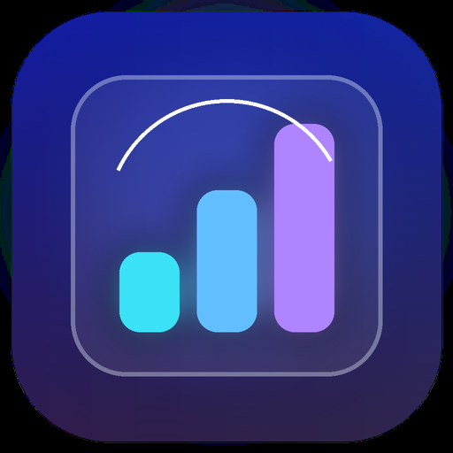

# AI Usage Bar

**Your AI subscription limits, at a glance.** A native macOS menu bar app for checking Claude Code and OpenAI Codex subscription windows without switching terminals or dashboards. See session and weekly limits, reset times, and manage multiple CLI profiles from one compact panel.

> **Early build:** this app is not signed or notarized. Claude `/usage` is plain text, not a documented stable interface. Review limitations before sharing or relying on it.

## Preview

| Menu bar icon | Usage panel |
|---|---|
|  | Screenshot coming soon — no real app screenshot has been captured yet. |

## Features

- Native macOS menu bar panel for Claude Code and Codex subscription usage.
- Used percentages, progress bars, reset times, and countdowns when available.
- Multiple independent CLI profiles; disconnected profiles stay in Settings.
- Refresh on launch, every five minutes, or on demand, with per-profile failure backoff.
- Local profile metadata kept separate from CLI credentials.

Only supported subscription accounts are shown. API-key/pay-as-you-go accounts and unsupported plans are not represented as subscription limits.

## Install a release

Download the universal macOS release asset from the repository's **Releases** page and move `AI Usage Bar.app` to `/Applications`. The universal build contains Apple Silicon (`arm64`) and Intel (`x86_64`) executables.

There is no signed/notarized public release yet. macOS may warn or block an app downloaded from GitHub. Do not bypass security warnings unless you trust the build and understand the risk.

## Requirements

- macOS 13 or later (build target; not yet verified on every supported version).
- Claude Code CLI and/or Codex CLI installed for the providers you use.
- A supported subscription logged in through the corresponding official CLI. The app does not perform interactive login itself.

## First launch and profiles

1. Open AI Usage Bar from `/Applications` (or your local build).
2. Open **Settings → Accounts**.
3. Activate a suggested Claude or Codex profile, or select a configuration directory. Suggestions inspect folder names such as `~/.claude*` and `~/.codex*`; they do not read profile contents until activated.
4. If a profile is not logged in, copy the offered login command, run it in Terminal, complete authentication with the official CLI, then refresh.

The app does not edit Claude Code's `settings.json`, install a status-line script, or read/store CLI tokens. Authentication and credential refresh remain the official CLIs' responsibility. Profile metadata is stored locally in `~/Library/Application Support/AIUsageBar/profiles.json` and contains no credentials.

## How usage is queried

**Codex:** the app uses the local `codex app-server` stdio protocol to read account and rate-limit information. This protocol is experimental and may change.

**Claude Code:** after checking `claude auth status`, the app runs `claude -p "/usage" --no-session-persistence` with the selected profile's `CLAUDE_CONFIG_DIR`, from a temporary working directory which is removed afterward. The persistence flag matters: without it, Claude Code may write a transcript for every query. The app does not parse or retain credentials.

Claude `/usage` is plain text, not a documented stable API. Parsing has only been observed with a Team subscription in English. A CLI update, another language, plan, or format may produce an “unrecognized format” state instead of usage. Other plans and languages are not verified.

Both CLIs may make their own network connections and manage their own credential storage. AI Usage Bar does not send profile data to an AI Usage Bar service and does not depend on Hermes.

## Build from source

Requires Xcode/Command Line Tools with Swift 5.9+, Python 3 with Pillow, and macOS tools including `iconutil` and `lipo`.

```sh
git clone <repository-url>
cd ai-usage-bar
./scripts/build-app.sh
open '.build/AI Usage Bar.app'
```

The build compiles `x86_64` and `arm64` slices for macOS 13+, combines them into a universal binary, generates the app icon, and assembles the `.app` bundle.

Run unit tests with `swift test`. Optional live tests use the local CLI login and may query real account status; they are not required for ordinary build/tests.

## Limitations and roadmap

- No signing/notarization pipeline yet; public distribution needs Developer ID signing and notarization.
- Universal slices are built locally; installation on a separate Apple Silicon Mac is not yet verified.
- Login is completed through the official CLI in Terminal, not an embedded login window.
- Claude text parsing and Codex app-server may change upstream.
- Accessibility, small screens, visual behavior across macOS versions, and auto-start need validation.
- Notifications and configurable thresholds are future work.

## Contributing and privacy

Never commit credentials, private CLI data, real usage transcripts, or personal screenshots. Use fake profiles and temporary directories in tests. See [the implementation plan](docs/plan.md) for architecture and known gaps.

## License and permissions

This repository is publicly visible for inspection, but the software is proprietary. **All rights are reserved.** No permission is granted to copy, modify, redistribute, bundle, resell, or use the software commercially without prior written authorization. See [LICENSE](LICENSE). GitHub visibility is not a software license. This is a project notice, not legal advice; have counsel review it if you plan formal commercial enforcement.
